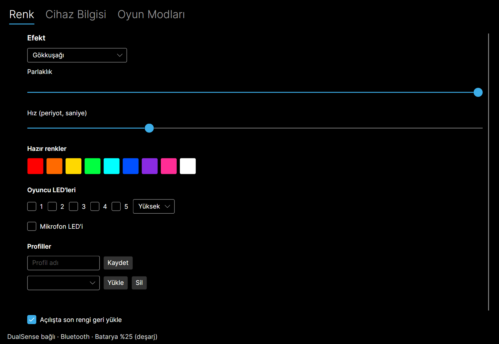
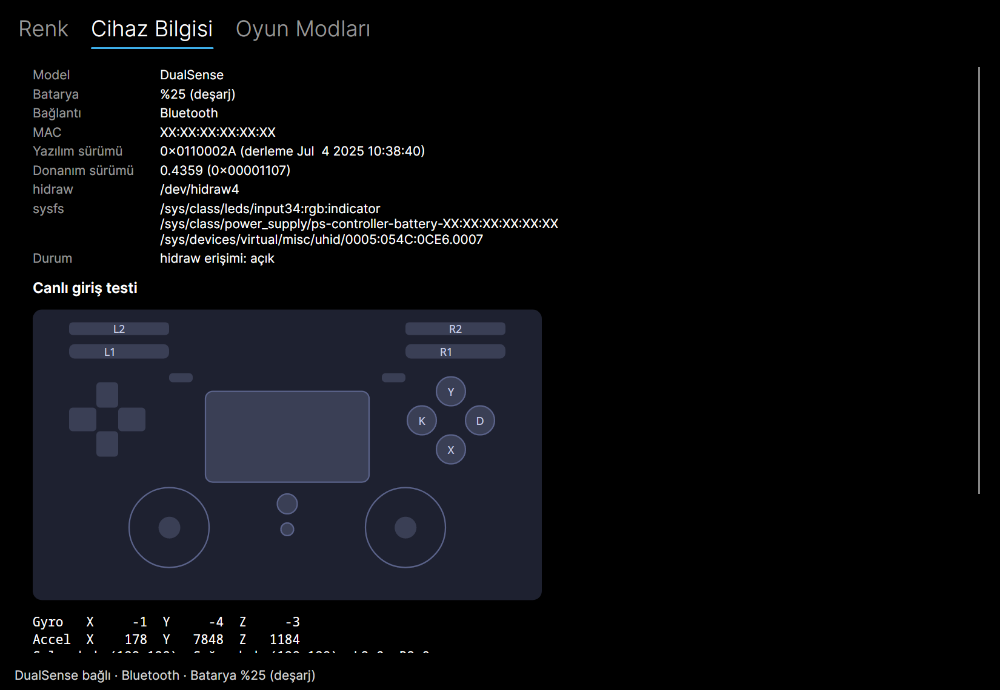
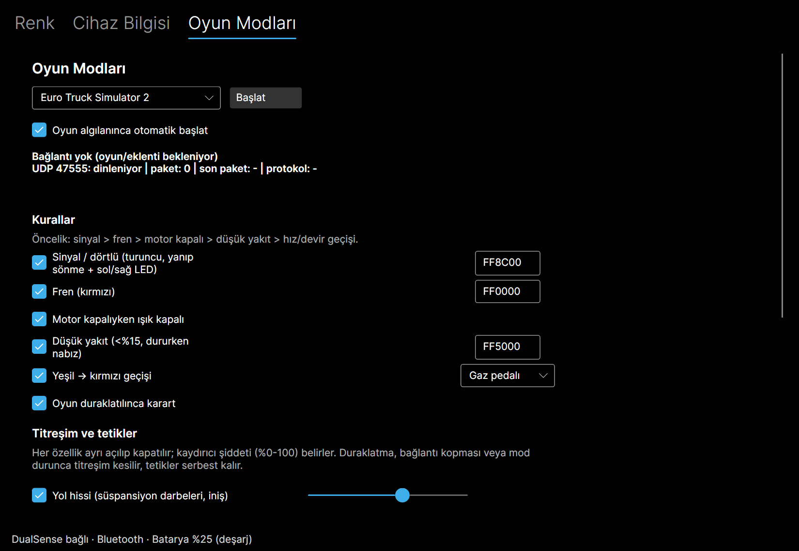
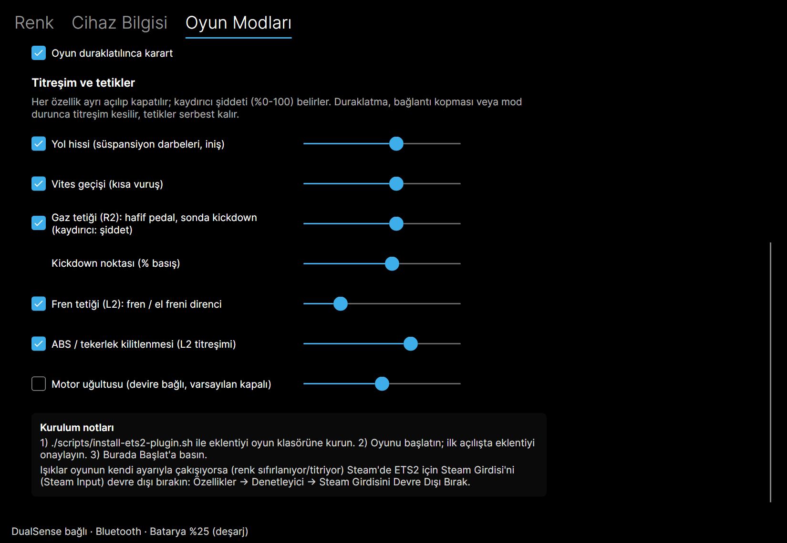

# DualSense Hub

[Türkçe](README.tr.md)

A Linux control center for the Sony DualSense (PS5) controller, with an Euro Truck Simulator 2 game mode.



- **Lightbar:** any color, brightness, presets, profiles and effects (static, breathing, rainbow, blink, battery-level color)
- **Player and mic LEDs**
- **Device info:** battery, connection type (USB/Bluetooth), MAC, firmware/hardware versions
- **Live input test:** buttons, sticks, triggers, gyro/accelerometer, touchpad; rumble and adaptive trigger tests
- **ETS2 mode:** turn signals blink the lightbar amber and light the matching side's player LEDs, brake turns it red, color follows how hard you press the throttle, plus haptics: road feel, gear-shift kick, brake trigger resistance, kickdown detent on the throttle trigger, ABS/wheel-lock trigger vibration and optional engine rumble
- **System tray** app with autostart; ETS2 mode starts automatically when the game is detected

Built with C# + Avalonia UI (.NET 10). Talks to the controller through the kernel `hid_playstation` driver (sysfs) and raw hidraw output reports (USB and Bluetooth, with CRC32).

## Screenshots



## Install

Requirements: .NET 10 SDK, a kernel with `hid_playstation` (any modern distro).

```bash
git clone https://github.com/msozturktr/DualSenseHub.git
cd DualSenseHub
./scripts/install-udev.sh   # once, needs sudo: lets your user access the controller
./scripts/install.sh        # user-level: publishes to ~/.local/share/dualsensehub, adds menu entry + autostart
```

Reconnect the controller after installing the udev rule. Then launch **DualSense Hub** from your app menu (or run `dualsensehub`). Closing the window keeps it in the tray; use **Çıkış** (Exit) in the tray menu to quit. Re-running `install.sh` updates the app and restarts the running instance. `./scripts/uninstall.sh` removes it (settings in `~/.config/dualsensehub/` are kept).

## ETS2 mode





ETS2 data comes from a small SCS Telemetry SDK plugin that sends UDP packets to `127.0.0.1:47555`. It is built as a Windows DLL (works with the Proton version of the game) using clang + lld + llvm-dlltool, no MinGW needed.

```bash
./scripts/install-ets2-plugin.sh   # builds if needed and copies the DLL to the game's bin/win_x64/plugins/
```

Set `ETS2_DIR=...` if the game is not in the default Steam library. Start the game and accept the "advanced SDK features" prompt. The app detects the game and starts the mode automatically (toggle in the **Oyun Modları** / Game Modes tab). Every rule and haptic effect can be switched on/off and its strength adjusted there. Packet format: [ets2-plugin/PROTOCOL.md](ets2-plugin/PROTOCOL.md).

Restart the game after updating the plugin.

## Steam

While Steam is running it may take over the controller and override the lightbar. If colors don't stick, disable Steam Input for PlayStation controllers (or for ETS2 in the game's controller properties). ETS2's own controller vibration can also conflict with the haptics; turn it off in the game options.

## Command line

| Command | What it does |
|---|---|
| `dualsensehub --status` | State of the running instance (UDP listener, packet count, connection, mode) |
| `dualsensehub --info` | Detected device paths, battery, firmware |
| `dualsensehub --set-color RRGGBB` | Set the lightbar and exit |
| `dualsensehub --apply-last` | Apply the saved color without UI |
| `dualsensehub --tray` | Start hidden in the tray |
| `dualsensehub --quit` | Quit the running instance |
| `--ets2-sim`, `--ets2-listen-test`, `--ets2-haptics-test`, `--rumble-test` | Development/testing helpers |

From the source tree use `dotnet run -- <args>`.

## Notes

- Lightbar control: the controller only accepts host colors after a one-time "lightbar setup" (`LIGHT_OUT`) command; the app sends it once per connection.
- Adaptive trigger parameters are based on community documentation and may feel different across hardware revisions.
- Tested on CachyOS (KDE) with a DualSense over Bluetooth.

## License

MIT, see [LICENSE](LICENSE). The ETS2 plugin uses hand-written declarations compatible with the SCS Telemetry SDK; see `ets2-plugin/sdk/SCS_SDK_LICENSE.txt`.

Not affiliated with or endorsed by Sony Interactive Entertainment or SCS Software. "DualSense" and "PlayStation" are trademarks of Sony Interactive Entertainment.
